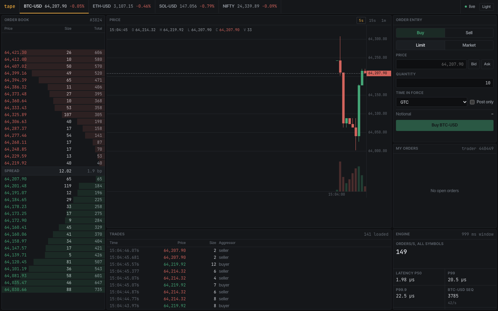

# tape

A limit order book matching engine in Go: price-time priority, deterministic, crash-recoverable from a write-ahead
log, with pre-trade risk checks, a conflated WebSocket market data feed, private execution reports and a trading
screen.

Live: [tape-exchange.vercel.app](https://tape-exchange.vercel.app). The engine runs on Render's free tier and
sleeps when idle, so the first load can take about a minute and books start fresh after a wake.



## Why this exists

Every exchange, from NSE to a crypto venue to a prediction market, sits on the same core: a matching engine that
has to be fast, strictly fair, deterministic, and able to rebuild its exact state after a crash. Most toy order
books get one of those right. tape tries to get all four and to back each with a test or a measurement: property
and fuzz tests for the matching rules, a crash test that SIGKILLs a real process at a random point and checks the
recovered event stream exactly, and benchmarks with the commands that produced them.

## Architecture

```
 browsers ── HTTP ──> api.Server ── pre-trade risk checks ──> TrySubmit (429 if the queue is full)
    ▲  ▲                                                          │
    │  │                                                          ▼
    │  │                                   per-symbol inbound channel (bounded)  <── sim bots (in-process)
    │  │                                                          │
    │  │                          engine goroutine (one per symbol, owns its book.Book)
    │  │                            1. stamp time; append the batch to the WAL; one write (+ fsync)
    │  │                            2. apply each command (no locks); reply to submitters
    │  │                            3. hand the batch to the feed; snapshot every N commands
    │  │                            4. a timer logs an expire command when an order's TTL is due
    │  │                                                          │ Publish (never blocks)
    │  │                                                          ▼
    │  └── WS /v1/ws/{symbol} <── feed.Feed: L2 mirror, tape, ticker; conflated every 100 ms
    └───── WS /v1/ws/private <── feed.Reports: acks, fills, amends, cancels per trader
```

| package | what it does |
| --- | --- |
| `book` | Single-symbol order book and matching. A pure state machine: no goroutines, no clock. Command codec, snapshot encoding, order expiry. |
| `wal` | Segmented append-only log with CRC-32C records, group commit, three fsync policies, atomic snapshot files. |
| `engine` | One goroutine per symbol: batching, durability, recovery, expiry timer, latency histogram; the `Exchange` router. |
| `feed` | Market data: L2 mirror, conflated sequence-chained updates, trades tape, gap resync, private execution reports. |
| `api` | REST and WebSocket gateway: risk checks, client order ids, rate limiting, connection caps, stats. |
| `sim` | Bot traders: market makers, a depth provider, noise and momentum takers around a mean-reverting fair price. |
| `hist` | Lock-free log-linear latency histogram. |
| `cmd/tape` | The server. `cmd/loadgen`: closed- and open-loop load generator. `web/`: React + TypeScript trading screen. |

## Design decisions

**One goroutine per symbol owns the book.** Matching takes no locks, and the order in which the engine dequeues
commands is the single total order everything else derives from. Symbols scale across cores independently; one hot
symbol is bounded by one core, the usual trade for an exchange.

**Price levels: a treap threaded with a sorted doubly linked list.** The treap gives O(log n) insert and remove of a
level; the list gives O(1) best price and O(1) step to the next level while sweeping. Each level is a FIFO list of
orders, and an id-to-order map gives O(1) cancel. Treap priorities are `mix(price ^ seed)` with a random seed per
book: no RNG state to keep, and because the seed is secret a client cannot pick prices that degrade the tree into a
list. The tree's shape never changes which order trades, so a recovered book with a different seed still emits the
same events. Alternatives and when they win:

- A flat array indexed by tick (price minus a floor, divided by tick size) gives O(1) everything and is what many
  production engines use, when prices live in a known, bounded band. It costs memory proportional to the band and
  a scan to find the next non-empty level after the best one empties. tape accepts any price up to 2^40 ticks, so
  it would need a sliding window plus an overflow structure.
- A skip list has the same expected bounds with simpler concurrent variants; with a single owning goroutine that
  advantage is moot, and it costs more pointers per level.
- A B-tree packs many levels per node and is cache friendlier for deep books with thousands of levels; for the
  tens to hundreds of active levels here, the treap plus the linked list is simpler and the best level is already
  one pointer away.
- Two heaps plus a map make removing an arbitrary emptied level awkward (lazy deletion), and cancels empty levels
  constantly.

**Integers everywhere.** Prices are int64 ticks and quantities int64 lots, each capped at 2^40. A level's total is a
sum of open quantities, so it could only overflow int64 with more than 2^23 maximum-size orders at one price, which
the open-order cap and the gateway's size limit make impossible. Price times quantity can exceed int64, so the
gateway computes notional in floating point. Order ids are `(symbol index + 1) << 40 | counter`, so cancels route
without a lookup, ids stay below 2^53 for JavaScript, and a book refuses new orders rather than let its counter
spill into the next symbol's range.

**Matching rules.** Limit, market (IOC or FOK), IOC, FOK, post-only (rejected if it would cross). Self-trade
prevention is cancel-newest: matching stops at the first resting order of the same trader, earlier fills stand and
the rest of the incoming order is cancelled. FOK checks fillability order by order, because STP could otherwise
leave it half filled. At most 200 resting orders per trader per book, enforced by the book itself so replay
enforces it identically; a per-trader index makes both the cap and "my open orders" cheap.

**Amend uses total quantity, as a FIX cancel/replace does.** The quantity in an amend is the order's new total,
including what has already filled. Reducing it at the same price keeps queue priority; any price change or increase
re-enters the order at the back and, if it now crosses, it trades. If the new total does not exceed what has
filled, the rest is cancelled. This matters because an amend races fills: a client that saw 10 open and asks for
"5 open" could, if 7 filled in between, end up with more exposure than intended. Asking for "a total of 5" when 7
have filled simply finishes the order.

**Pre-trade risk checks (price collar and fat-finger limits).** Every order from outside passes these in the
gateway before it reaches an engine; the bots run in-process and bypass them:

- Price band. A limit price must be within 10% of the reference price (the last trade, else the mid, else the
  symbol's configured reference) and within 25% of the configured reference. The dynamic collar catches fat
  fingers; the static band stops two accounts from walking the last price away in collar-sized steps.
- Market protection. A market order is sent as an IOC (or FOK) limit at the edge of the band, so it can never
  sweep the book beyond it.
- Size. At most 10,000 lots and 5,000,000 notional per order.
- Order lifetime. Resting GTC orders from outside get a time to live (30 minutes by default). The engine expires
  them deterministically: a timer notices the earliest expiry is due and issues an expire command, which is
  logged like any other command, so replay expires the same orders at the same point in the stream.

Without these, one request (a buy at price and quantity 2^40) swept the demo book, pinned last and high at 2^40,
and left every bot ask rejected as crossing, even across restarts. That request is now a test case.

**Commands that are invalid on their face never reach the log.** Bad side, type, quantity or trader is rejected in
`Submit` with a sequence number of 0, so garbage costs neither a log record nor a sequence number. Rejections that
depend on the book's state (unknown order, post-only would cross) are logged and sequenced as normal.

**The book never reads a clock.** The engine stamps each command when it dequeues it and that timestamp is written
to the log with the command, so replay regenerates events identical down to the timestamps.

**WAL before apply, with group commit.** The engine drains what is queued (up to 256 commands), appends them all,
issues one `write` and, under `batch`, one fsync, and only then applies them. Nothing anyone sees, including the
submitter's reply, exists before it is in the log. If the log fails the engine stops (fail-stop) rather than let
the book run ahead of what recovery can rebuild, and `/healthz` turns unhealthy. Sync policies:

- `batch`: fsync before every acknowledgement. The claim that an acknowledged order survives a power cut rests on
  that ordering (fsync returns before the reply is sent), not on a test: nothing here simulates power loss.
- `interval`: a background fsync every 10 ms. A process crash loses nothing, because the data is already in the
  page cache; a power failure can lose up to one interval.
- `none`: flushing left to the OS.

The crash test kills the process with SIGKILL, which leaves the page cache intact, so it cannot tell these policies
apart: it proves that recovery is exact for whatever reached the file, not that the file reached the disk.

**Records and torn tails.** A record is `len | CRC-32C | index | payload`, the checksum covering the index too. On
open, the newest segment is cut back to its last valid record: a torn write, garbage or a corrupt last record is
truncated, and a torn segment header is recreated. Damage in an older, sealed segment cannot come from a crash, so
replay refuses with `ErrCorrupt` instead of silently skipping commands. Trade-off: a bad record in the middle of the
newest segment is treated as a torn tail and what follows is dropped; with fsync per batch only the last batch can
be affected.

**Snapshots.** Every 50k commands the engine encodes the book on its own goroutine, rotates the log so the snapshot
boundary is a segment boundary, and writes the file from a helper goroutine (temp file, fsync, rename, fsync dir).
Once it is durable, log segments and snapshots older than the previous snapshot are deleted, so a damaged or
unrestorable newest snapshot falls back to the older one plus a longer replay (both tested). A clean shutdown
writes a final snapshot so restarts replay nothing.

**Market data is decoupled from matching, and conflated.** The engine hands each batch to `feed.Publish`, which
never blocks: if the feed's buffer is full the batch is dropped and counted. Every 100 ms the feed sends one update
with the latest quantity of each level that changed and the trades since the last update; `seq` and `prev` chain
the messages so a client can tell it missed one. If the feed notices a gap it rebuilds its mirror from the engine
and sends every subscriber a fresh snapshot in place, rather than disconnecting them. The engine answers that query
between two commands of a batch it has not published yet, so the batch that follows can overlap the rebuilt state;
the feed skips the events it already reflects. Snapshots are always full depth (a depth-limited client could not
apply deltas below its cut-off without holes) and carry an epoch that changes when the server restarts, because
sequence numbers restart with it. Each subscriber has a bounded buffer; a full buffer or a write slower than 5 s
drops that client with close code 1008 and nobody else notices. Updates use permessage-deflate.

**Private execution reports.** `/v1/ws/private?trader=ID` streams acks, fills (both sides, with maker or taker),
amends and cancels for one trader, unconflated. The trading screen keeps "my orders" from it instead of polling.
Like the rest of the API it trusts the trader id: there are no accounts.

**Retries and overload.** An order may carry a `client_order_id`; the gateway remembers it per trader for ten
minutes, so a resend returns the first outcome instead of placing a second order. The gateway submits without
waiting for queue space: a full engine queue is a 429 at once. If an order was queued but its result did not come
back within 5 s, the answer is 503 `pending`: the order may still execute, and resending with the same
`client_order_id` returns what happened. The id store is in memory and forgotten on restart.

**Allocation work.** The book recycles orders and price levels through free lists and reuses its event buffer, so
in steady state it allocates nothing per command (2 allocs/op before). Consequence: `Book.Apply`'s result is valid
only until the next call and `Book.Order` pointers only until the next `Apply`. The engine copies a batch's events
into one slice per batch, which is the remaining allocation (about 380 B per command, amortised so that the
benchmark reports 0 allocs/op). Reply channels come from a `sync.Pool`.

**Public demo safety.** Ids below 1000 belong to the bots and are refused at the gateway. Order entry and order
queries are rate limited per client address (token bucket, 20/s, burst 40) in a table capped at 50,000 addresses;
behind a proxy the address is the right-most `X-Forwarded-For` entry the proxy added (`TAPE_PROXY_HOPS`), never one
the client could forge. WebSocket connections are capped at 8 per address and 500 in total. Bodies are capped at
4 KB (413 beyond).

## Running locally

Requires Go 1.27 and Node 25.

```sh
go run ./cmd/tape                       # :8081, WAL in ./data, bots on
cd web && npm install && npm run dev    # http://localhost:5174, proxies /v1 to :8081
```

Configuration is environment only; see `.env.example` (server) and `web/.env.example` (frontend). Load tests need
`TAPE_RATE_LIMIT=0`, and usually `TAPE_SIM=false`.

API:

```
GET    /v1/symbols                    ticker, price band and size limits per symbol
GET    /v1/book/{symbol}?depth=20     L2 book
GET    /v1/trades/{symbol}?limit=100  recent trades, oldest first
GET    /v1/stats                      orders/s, latency p50/p99/p99.9, WAL written/synced/lag, feed drops
GET    /v1/orders?symbol=S            open orders of X-Trader-ID
POST   /v1/orders                     {"symbol","side","type","tif","post_only","price","qty","client_order_id"}
PATCH  /v1/orders/{id}                {"price","qty"}  (qty is the new total; 0 = unchanged)
DELETE /v1/orders/{id}
GET    /v1/ws/{symbol}                snapshot, then {"type":"update","seq","prev","deltas","trades"}
GET    /v1/ws/private?trader=ID       execution reports
GET    /healthz                       503 if any engine has stopped
```

## Tests

```sh
go test -race ./...                                    # everything, including the crash test
go test -run '^$' -fuzz FuzzBook -fuzztime=60s ./book
go test -run '^$' -bench . -benchtime=2s ./book ./engine
cd web && npm run lint && npm run build && node scripts/smoke-ws.mjs http://localhost:8081 6
```

- `book`: table-driven tests per rule, including total-quantity amends, the open-order cap, TTL expiry and order
  id exhaustion; randomized streams and a fuzz target that after every command check the book is never crossed,
  quantity is conserved per order, sequence numbers strictly increase, fills respect limit prices and price-time
  priority (against an independent ledger rebuilt from events), the trader index is consistent, and a clone
  restored from a mid-stream snapshot stays event-for-event identical.
- `wal`: every torn cut of the last record, bit flips, absurd lengths, torn segment headers, rotation and pruning,
  damage in sealed segments, snapshot fallback.
- `engine`: identical events and hash from two in-memory runs and one durable run; the SIGKILL crash test (nine
  trials across the three sync policies and three tail-damage modes); expiry from the timer; invalid commands kept
  out of the log; `TrySubmit` failing fast.
- `feed`: conflation, gap resync with in-place snapshots, overlap trimming, slow-subscriber drops, private reports.
- `api`: a real HTTP server and real WebSocket clients: the risk checks (including the 2^40 attack), client order
  id retries, a client with a 1 KB receive buffer dropped while three others get an unbroken sequence and end with
  the server's exact book, private reports, connection caps, trusted proxy hops, clean body errors.

## Results

Measured on an Apple M4, 16 GB, macOS, Go 1.27.4. The machine was not quiet: it was on battery in Low Power Mode
with other workloads running (load average 4 to 9 during these runs), so absolute numbers are lower than an idle
machine would give. Comparisons within a table were run back to back under the same conditions. Every number comes
from `VERIFICATION.md`, which has the full output and commands.

### Matching core

`go test -run '^$' -bench . -benchtime=1s -count=5 ./book`, median of 5, the same benchmark file run at three
commits back to back: `1089969` (before the allocation work), `34ff67b` (after it) and the current code, which
adds the per-trader index, total-quantity amends, TTLs and the open-order cap.

| benchmark | 1089969 | 34ff67b | current | current allocs/op |
| --- | --- | --- | --- | --- |
| ApplyMixed: 60% limit, 10% market, 25% cancel, 5% amend | 204.7 ns | 115.2 ns | 144.5 ns | 0 |
| RestAndCancel: 100k orders over 1000 traders, then cancel all | 262.3 ns | 112.6 ns | 162.5 ns | 0 |
| Sweep: 5 resting orders, then a market order taking all 5 | 325.9 ns | 102.3 ns | 131.9 ns | 0 |

ns/op is per command (a sweep is six commands). The allocation work removed 2 to 4 allocations per command; the
features added since (the per-trader index, which bisecting shows is most of it, plus TTLs and total-quantity amends) cost back about 30 ns. At 144.5 ns the mixed stream runs
at about 6.9M commands per second on one core. About 10% of that stream is cancels that lose the race with a fill
and are rejected as unknown, as they would be on a real venue.

### Engine pipeline (`./engine`, one submitter per GOMAXPROCS, i.e. 10)

| benchmark | 1089969 | 34ff67b | current |
| --- | --- | --- | --- |
| SubmitInMemory | 1365 ns, 5 allocs | 1240 ns, 0 allocs | 1226 ns, 0 allocs |
| SubmitWALNoSync | 2479 ns, 5 allocs | 1694 ns, 0 allocs | 1632 ns, 0 allocs |

The "0 allocs" is the per-batch event slice amortised over the batch (about 370 to 380 B/op). Recovery: replaying
100k logged commands with no snapshot (`BenchmarkRecoverReplay`) takes a median 20.6 ms, about 4.9M commands/s.

### Load generator

The default mode is closed loop: each worker waits for its result before sending again. When the system stalls,
the workers stop sending, so stalls are under-sampled (coordinated omission) and the percentiles look better than
what a client arriving at a steady rate would see. `-rate` runs open loop instead: commands are scheduled at a
fixed arrival rate and latency is measured from each command's scheduled time. Both are reported. `engine_rejections`
is the share of commands the engine rejected (mostly cancels that lost a race with a fill).

In-process, WAL on (`./bin/loadgen -mode=engine ...`, 4 symbols, 10 s):

| sync | load | throughput | p50 | p99 | p99.9 |
| --- | --- | --- | --- | --- | --- |
| batch | closed, 16 workers/symbol | 2,954/s | 23.1 ms | 31.5 ms | 126 ms |
| batch | closed, 256 workers/symbol | 53,819/s | 16.3 ms | 39.8 ms | 159 ms |
| batch | open, 2,000/s | 1,997/s | 13.6 ms | 24.1 ms | 27.3 ms |
| interval | closed, 16 workers/symbol | 7,270/s | 10.5 ms | 21.0 ms | 26.2 ms |
| none | closed, 16 workers/symbol | 398,714/s | 102 µs | 950 µs | 4.19 ms |
| none | open, 100,000/s | 100,000/s | 20.5 µs | 18.9 ms | 35.7 ms |

Over HTTP against `./bin/tape` (`TAPE_SIM=false TAPE_RATE_LIMIT=0`), 4 symbols, 10 s:

| sync | load | throughput | p50 | p99 | p99.9 |
| --- | --- | --- | --- | --- | --- |
| batch | closed, 32 clients/symbol | 5,056/s | 24.1 ms | 54.5 ms | 79.7 ms |
| batch | open, 2,000/s | 1,998/s | 15.2 ms | 29.4 ms | 46.1 ms |
| none | closed, 32 clients/symbol | 41,499/s | 2.36 ms | 12.6 ms | 19.9 ms |
| none | open, 20,000/s | 19,997/s | 246 µs | 18.9 ms | 56.6 ms |

With `batch`, this Mac is bound by fsync: Go's `File.Sync` on macOS issues `F_FULLFSYNC`, which flushes the drive's
write cache. I did not time fsync on its own; the closed-loop p50 of 23.1 ms with `batch` against 102 µs with
`none` shows where the time goes. Group commit
is what turns that into tens of thousands of orders per second: 256 workers per symbol give about 18 times the
throughput of 16 at a similar fsync rate, because each flush carries a larger batch. `interval` on macOS measured
well short of `none`; I have not isolated why, so I make no claim about the cause. Without fsync the HTTP gateway,
not the engine, is the limit. Percentiles come from a log-linear histogram with about 6% bucket error.

### Demo footprint

The release image (`docker build`, 15.9 MB) run as Render's free tier would run it, `docker run --memory=512m
--cpus=0.1`, with the bots at the default intensity: became healthy 0.18 s after `docker run`; after 4 hours and
1.56M commands it was using 1.4% to 3.9% of a core (the cap is 10%) and 8.5 to 9.2 MiB of memory, its data
directory held 25.7 MB, and a 30-second WebSocket smoke test against it passed on all four symbols.

One browser tab on the trading screen, measured through a byte-counting proxy for 125 s
(`web/scripts/measure-tab.sh`), server-to-client bytes including the initial page data:

| build | bots | bandwidth |
| --- | --- | --- |
| before (`963a7a9`: an update per batch, 2 s and 1 s polls, no compression) | intensity 1 | 10.63 KB/s (37.4 MB/h) |
| current (100 ms conflation, deflate, 10 s and 5 s polls, my orders pushed) | intensity 1 | 1.36 KB/s (4.8 MB/h) |
| current, default settings | intensity 0.5 | 0.92 KB/s (3.2 MB/h) |

A hidden tab costs nothing: the sockets close and polling stops until the tab is visible again, when the feed
resyncs from a fresh snapshot.

## Deployment

**Backend on Render (free tier).** `render.yaml` is a Blueprint: in the Render dashboard choose New > Blueprint and
point it at the GitHub repository. It builds the `Dockerfile` (a static binary on distroless, running as uid 1000)
as a free web service with health check `/healthz`. Render injects `PORT`. Set `TAPE_CORS_ORIGINS` to the Vercel
URL when prompted. The other values in the Blueprint (`TAPE_WAL_SYNC=interval`, `TAPE_PROXY_HOPS=1`,
`TAPE_SIM_INTENSITY=0.5`) suit the free plan.

What the free plan means for the demo: the service sleeps after 15 minutes without traffic and takes about a minute
to wake, and `/tmp`, where the log lives, is wiped on every wake. So each wake starts with fresh books and fresh
sequence numbers; the server's epoch tells open browser tabs to drop what they held. While it wakes the frontend
shows "Waking the demo server, about a minute" and retries on its own. Bandwidth is capped at 5 GB a month; at the
measured 3.2 MB per tab-hour that is roughly 1,600 tab-hours.

**Frontend on Vercel.** Import the repository with root directory `web`, framework Vite, build command `npm run
build`, output directory `dist`, and set at build time `VITE_API_URL=https://<service>.onrender.com` and
`VITE_WS_URL=wss://<service>.onrender.com`.
